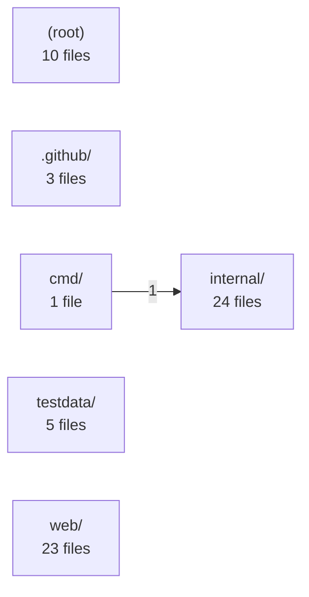

# r2m

*repo → Mermaid.* **See how a project is built.** Point it at a folder or a public GitHub repo and
get an overview, a "which file uses which" graph and a folder tree as
[Mermaid](https://mermaid.js.org) diagrams. Static analysis only: no AI, no API
key, nothing is executed, no account needed.

A single small program: nothing to install first, and it works offline.

## Install

r2m is one file. There is no installer and nothing else to set up.

1. Open the [Releases](https://github.com/originalpages/r2m/releases) page and
   download the file for your computer:

   | Your computer | Download |
   |---|---|
   | Windows | `r2m_<version>_windows_amd64.zip` |
   | Mac (Apple chip: M1, M2, ...) | `r2m_<version>_darwin_arm64.tar.gz` |
   | Mac (Intel) | `r2m_<version>_darwin_amd64.tar.gz` |
   | Linux | `r2m_<version>_linux_amd64.tar.gz` |

2. Unzip it. You get a file called `r2m` (`r2m.exe` on Windows).
3. Put it somewhere you can reach from a terminal, for example:

   - **Windows:** double-click `r2m.exe` to try it, or open PowerShell in that
     folder and run `.\r2m.exe`. If Windows says "protected your PC", click
     *More info* → *Run anyway* (the program is not code-signed).
   - **Mac:** open Terminal in that folder and run
     `xattr -d com.apple.quarantine r2m` once, then `./r2m`.
   - **Linux:** `chmod +x r2m && ./r2m`

   To run it from any folder, move it to a folder on your PATH, e.g.
   `mv r2m ~/.local/bin/` (Linux/Mac).

Prefer Go? `go install github.com/originalpages/r2m/cmd/r2m@latest`

No terminal at all? Use the web page (GitHub Pages) and paste a repo address.

## Quick start

Open a terminal in (or point it at) the project you want to look at:

```bash
r2m                        # asks what you want to see
r2m my-project             # everything, opened in your browser
r2m my-project overview    # overview | deps | folders | all
r2m owner/repo             # a public GitHub project
r2m my-project deps save   # save as a Markdown file instead
r2m help
```

Leave the folder out to use the folder you are in. If a folder is literally
named `deps` or `save`, the folder wins over the word.

The browser page shows three diagrams. Each one has **Save as picture (PNG)**,
**Save as SVG**, **Copy Mermaid source** and zoom (− / + / Fit). Pictures carry
the project name and a footer with this project's GitHub URL (and the source
URL when you analysed a GitHub project). Everything works offline.

## Troubleshooting

| Problem | What to do |
|---|---|
| Browser did not open | Open the file path r2m prints, or run `r2m <folder> deps save` to get a Markdown file. |
| "is not a folder here and not a GitHub project" | Check the spelling, or use `owner/repo` for a GitHub project. |
| "could not download ..." | Only **public** GitHub projects work, and `git` must be installed. For a private project, clone it yourself and run r2m on the folder. |
| Dependencies diagram says no imports were found | r2m reads JavaScript/TypeScript, Python, Go and Java/Kotlin imports. Other languages only get the Folders diagram. |
| Dependencies diagram is very wide | Big projects get a **Show:** picker above the diagram. Pick a folder to see its files in detail (dashed boxes are other folders it connects to). From a script: `r2m . -t deps --focus src/components`. |
| Diagram is tiny or huge | Use the − / + / Fit buttons, or `-n 40` (fewer boxes) / `-d 2` (fewer folder levels). |
| Very large files are ignored | Files over 2 MB (minified bundles) are skipped on purpose. |

## What you get

| Word | Diagram | What it shows |
|---|---|---|
| `overview` | `arch` | Main folders and how they depend on each other (import counts) |
| `deps` | `deps` | File-to-file import graph, grouped by folder |
| `folders` | `tree` | Folder and file structure |

Example: the overview of this repository:

<!-- r2m:start -->

<!-- r2m:end -->

Supported languages for `deps` and `overview`: JavaScript/TypeScript, Python,
Go and Java/Kotlin imports.

## For scripts and READMEs

Any option prints plain Mermaid text (no browser):

```text
r2m [folder|owner/repo|https-url] [options]

  -t, --type <tree|deps|arch>   diagram type (default: tree)
  -d, --depth <N>               max folder depth
  -n, --max-nodes <N>           max nodes before collapsing
  -o, --out <file>              write to file instead of stdout
      --focus <folder>          with -t deps: one folder in detail (e.g. src/components)
      --md                      wrap output in a ```mermaid fence
      --update <file>           update the marker block in a Markdown file
      --view / --no-view        force the browser view / force text output
```

- GitHub inputs are shallow-cloned with `git` into a temp folder and removed
  afterwards (needs `git`).
- The root `.gitignore` is respected (nested ones are not); `node_modules`,
  `.git`, `dist`, `build` and similar are skipped.
- Above `--max-nodes` a diagram is collapsed automatically. Mermaid refuses to
  render more than 500 edges, so the lightest edges are dropped beyond that.
- Import resolution is heuristic. It understands relative imports, Python
  packages, Java/Kotlin packages, `go.mod` module paths and `tsconfig.json` /
  `jsconfig.json` `baseUrl` + `paths` (`extends` is not followed). Third-party
  packages are not drawn, but a Python import that shares a name with a local
  module can produce a false edge.
- Exit codes: `0` ok, `1` runtime error, `2` usage error.

### Keep a diagram in your README

`--update README.md` rewrites the block between these markers (and appends it
to the end of the file if it is missing):

```md
<!-- r2m:start -->
<!-- r2m:end -->
```

## GitHub Action

```yaml
- uses: actions/checkout@v4
- uses: originalpages/r2m@v0
  with:
    path: .
    type: arch
    depth: 3
    max-nodes: 60
    output: docs/diagram.md   # optional; parent folders are created
    update-readme: 'true'     # optional; updates the marker block
```

The action only writes files in the runner workspace. Commit the result with
your preferred step (e.g. `stefanzweifel/git-auto-commit-action`).

## Web page

A static page that takes a public GitHub repo and draws the diagram in the
browser (unauthenticated GitHub API, 60 requests/hour). It lives in `web/` and is
deployed to GitHub Pages by `.github/workflows/pages.yml`. It uses a TypeScript
port of the same engine; `internal/core` (Go) is the reference implementation.

## Development

```bash
make test        # go vet + go test -race
make build       # ./r2m
make web-test    # web page: npm ci, tests, build
```

See [CONTRIBUTING.md](CONTRIBUTING.md). Security issues: [SECURITY.md](SECURITY.md).

## License

[MIT](LICENSE). The embedded Mermaid library is MIT-licensed too, see
`internal/cli/assets/MERMAID_LICENSE`.
